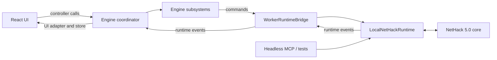

# Polypiled: a random NetHack variant

Polypiled is a NetHack variant with its own 3D interface. The game core is
NetHack 5.0, built from the modified source in [core/](core/README.md); the
rules differ from NetHack 5.0 only where [Rule Changes](docs/rule-changes.md)
says so. Play it from above, in first person, in a classic terminal view, or in
virtual reality on Meta Quest.

**[Play in your browser](https://kafuji.github.io/Polypiled/)** ·
[Rule Changes](docs/rule-changes.md) · [Get the game](#get-the-game) ·
[Run locally](#run-locally) · [Headless play and tests](#headless-play-and-tests) ·
[Privacy Policy](https://kafuji.github.io/Polypiled/privacy.html)

Polypiled grew out of [NetHack 3D](https://github.com/JamesIV4/nethack-3d) by
James Pound and is maintained by [kafuji](https://github.com/kafuji). It was
first developed as the fork "NetHack 3D Plus".

## What Polypiled changes

### The game

Each change in the C source is marked with a `Polypiled:` comment, and
[Rule Changes](docs/rule-changes.md) describes them in full. In short:

- **Food and hunger:** food no longer spoils at random, hunger gives more
  warning before it turns dangerous, overeating no longer chokes, and
  plant-eating pets can find food.
- **Character growth:** experience levels follow one smooth curve, weapon skill
  carries over within a weapon family, lowered characteristics recover with
  time, Pw regenerates faster at low level, and spells are not forgotten.
- **Equipment:** worn armor counts for half its weight, missiles break less
  often, artifacts can be the secondary weapon, fire, cold and lightning
  destroy fewer items, and a bag of holding warns before an explosion it can
  foresee.
- **The dungeon:** a "midway" set piece at depth 13–16, a thieves' den with a
  black market above Medusa, fountains with their own water and a wonder,
  sinks reworked as a tap, fewer mazes in Gehennom, no mysterious force, and
  no monsters in Sokoban that stay put and block the puzzle.
- **Shops and people:** no mimics in shops; shopkeepers defend customers,
  restock, identify for a fee and take back goods pets carry off; temple
  priests read blessings; pets take orders through `#chat`.
- **Knowledge:** what anyone can tell by looking at a monster is shown, some
  items are identified by an obvious effect, and polypiling works on a whole
  square at once.

Accepted ideas that are not implemented yet are collected in
[Rule candidates](docs/rule-candidates.md).

### The interface

- **Inventory screen** (`Shift+I`): a grid with by-kind view and sorting,
  containers opened beside the pack, Shift-drag to move part of a stack, and
  named equipment sets (`Alt+1`–`Alt+3`).
- **Map and hover label:** hovering a square tells its ground, feature, trap
  and top object; a bottom panel shows where the hero stands and what lies
  there. What the hero does not see is drawn at half brightness, and a plain
  left click only moves, attacks or travels (doors are opened, unlocked or
  kicked without asking for a direction; wading into known water asks first).
- **Graphics:** a high-resolution tile pack with painted terrain, items and
  characters, 3D models for stairs, doors, fountains and other features,
  soft lighting, wielded weapons drawn in the hero's hand, and sprites that
  stand on the floor with shadows. Classic tilesets, 3D ASCII and Vulture
  artwork remain available.
- **Combat feedback:** floating damage numbers for the blows the hero deals,
  misses on both sides, and an experience bar.
- **Portrait dialogue:** optional portraits for conversations, shopkeepers,
  the Oracle and quest narration.
- **Music:** the "Takachiho" soundtrack follows where the hero is and what is
  happening.
- **Japanese:** a full interface translation, with in-game messages, prompts,
  item names and quest texts translated at display time. The project's own
  translations come first, then unreviewed Nehww references marked 参考訳.

## Get the Game

### Browser and iPhone/iPad

[Play in your browser](https://kafuji.github.io/Polypiled/). On iPhone or
iPad, open the link in Safari, tap Share, then `Add to Home Screen` and launch
it from the Home Screen for full screen.

### Windows, macOS, Linux, Android and Meta Quest

Packages are published on the
[Releases page](https://github.com/kafuji/Polypiled/releases) when a release
is made; until then, build them with the [scripts](#scripts) below.

- Windows: an x64 installer and a portable app.
- macOS: an unsigned DMG. On first launch, right-click the app and choose
  `Open`.
- Linux / Steam Deck: an AppImage. Add it to Steam with "Add Non-Steam Game to
  My Library" and keep Proton disabled. `--windowed` launches in a framed
  window and `--borderless` in a frameless one. A suggested Steam Input
  profile: left trackpad as Left Joystick, trackpad click as A.
- Android and Quest have separate APKs. The Quest APK bundles the game and its
  VR host for offline play without a PC; sideload it as usual.

## Ways to Play

| View                  | Experience                                                                                                      |
| --------------------- | --------------------------------------------------------------------------------------------------------------- |
| Overhead 3D           | Survey the dungeon, pan and rotate the camera, and zoom from individual tiles to a whole-level overview.        |
| First person          | Explore from inside the dungeon with mouse, touch, or controller input.                                         |
| Terminal              | Play in a crisp, zoomable grid with the game's native characters, colors, symbol sets, and highlighting.        |
| Quest tabletop VR     | View the dungeon as a board you can move, tilt, scale, and pan with tracked controllers.                        |
| Quest first-person VR | Step into a room-scale dungeon with tracked controllers, snap turning, and adjustable world scale.              |

Controls cover keyboard and mouse (with extended-command autocomplete and
context actions), controllers (radial action menus), touch (tap and swipe
movement, quick actions) and Quest controllers (floating panels, a virtual
keyboard and a hotbar). Hotbars for desktop, mobile/VR and the Menu / Actions
layout are configured in **Options → Hotbar**. You can import your own
tilesets and edit sound packs in the game.

## Screenshots

<table>
  <tr>
    <th>Combat in the Gnomish Mines</th>
    <th>Shatter monsters into pieces!</th>
  </tr>
  <tr>
    <td><a href="docs/screenshots/combat-gnomish-mines.png"></a></td>
    <td><a href="docs/screenshots/combat-effects.png"></a></td>
  </tr>
  <tr>
    <th>Multiple tile sets</th>
    <th>Inventory</th>
  </tr>
  <tr>
    <td><a href="docs/screenshots/tile-sets.png"></a></td>
    <td><a href="docs/screenshots/inventory-panel.png"></a></td>
  </tr>
  <tr>
    <td colspan="2"><a href="docs/screenshots/terminal-mode.png"></a></td>
  </tr>
</table>

Some screenshots date from NetHack 3D and do not show Polypiled's own tiles
and interface yet.

## Run Locally

Node.js 24 is used in CI.

1. `npm i`
2. `npm run dev`
3. Open `http://localhost:5173/`

On Windows you can also start the server and open the game from PowerShell:

```powershell
powershell -ExecutionPolicy Bypass -File .\start-local.ps1
```

Keep the terminal open while playing and press `Ctrl+C` to stop. The script
uses `http://127.0.0.1:5173/` and reports an error if the port is busy.

### The game core

The shipped core is `public/nethack-5.js` and `public/nethack-5.wasm`. It is
built from [core/](core/README.md) by the `build-core-wasm.yml` workflow, and a
change to the C source ships as a commit of the built files. `core/build-wasm.sh`
builds it locally. After the core changes, `npm run glyphs:generate` updates
the glyph catalog.

### Quest development

The [Quest WebXR guide](docs/quest-webxr-runtime.md) covers prerequisites,
controller mappings, signing and device checks. `npm run quest:webxr:wired`
tests with Quest Link; `npm run quest:webxr:apk -- --debug` builds a standalone
debug APK after `npm ci` and the documented Android/JDK tools. The build
downloads and verifies its pinned Meta SDK and patched GeckoView.

## Headless Play and Tests

The real runtime and core also run in Node without a browser. The
[headless MCP server](docs/mcp-headless.md) lets an MCP client start games
(with seeds, chosen characters and debug mode), observe, act, travel, read the
inventory and take snapshots:

```powershell
claude mcp add polypiled -- node scripts/mcp/headless-server.mjs
```

- `npm test` - Unit and regression tests (Vitest).
- `npm run test:headless` - The headless runner, the MCP server, and the rule
  changes checked against the real core.
- `npm run test:rules` - Only the rule-change tests
  (`scripts/headless/rules.test.mjs`).
- `npm run check:tsc` - Type-check the client and the headless build.

CI runs all of these on every pull request.

## Scripts

### Development

- `npm run dev` - Start the Vite dev server.
- `npm run build` - Build production bundles.
- `npm run preview` - Preview the production build.
- `npm run i18n:check` - Check the translations.
- `npm run glyphs:generate` / `npm run glyphs:check` - Regenerate or verify the
  glyph catalog.

### Desktop packages

- `npm run electron:dev` - Run Electron against the dev server.
- `npm run electron:dist:win` / `electron:dist:win:portable` - Windows x64
  installer / portable app.
- `npm run electron:dist:mac` - macOS DMG (`-- --universal` for a universal
  build).
- `npm run electron:dist:linux:appimage` - Linux AppImage (uses WSL on
  Windows).
- `npm run electron:dist:all` (`:parallel`) - Windows and Linux packages from
  one shared build.

On Windows, AppImage packaging builds the web assets with Windows Node, then
packages inside WSL under `~/.cache/polypiled/appimage/<checkout-id>/`; only
the finished artifacts come back to `release/`. WSL needs Linux Node/npm,
`rsync` and `libcups.so.2`. `NH3D_SKIP_ELECTRON_BUILD=1` reuses a current
`dist/`, `NH3D_ELECTRON_OUTPUT_DIR` changes the Windows output, and
`NH3D_APPIMAGE_PREPARE_ONLY=1` / `NH3D_APPIMAGE_SKIP_PREPARE=1` split staging
from packaging.

### Android and Quest packages

- `npm run android:sync` - Build web assets and sync the Android project.
- `npm run android:release` - Build a signed release APK
  (`release/Polypiled <version> Android.apk`); `-- --check` only checks
  prerequisites and signing.
- `npm run quest:webxr:apk` - Build a signed Quest APK (`-- --debug` for a
  debug build); see
  [version codes](docs/quest-webxr-runtime.md#automatic-upload-version-codes).

For Android signing, copy `android/keystore.properties.example` to
`android/keystore.properties` and fill in the release keystore path, alias
and passwords (forward slashes on Windows; relative paths resolve from
`android/`). The properties and keystore files are ignored by Git.
`NH3D_ANDROID_STORE_FILE`, `NH3D_ANDROID_STORE_PASSWORD`,
`NH3D_ANDROID_KEY_ALIAS` and `NH3D_ANDROID_KEY_PASSWORD` override them.

## Architecture

[src/main.tsx](src/main.tsx) mounts [App.tsx](src/ui/App.tsx). The
[React UI modules](src/ui/README.md) own startup, dialogs, client options and
interaction state. [Nethack3DEngine.ts](src/game/Nethack3DEngine.ts)
coordinates the engine subsystems under
[src/game/engine/](src/game/engine/README.md) (rendering, input, camera, world,
menus, audio, diagnostics). The game's state and rules run in WebAssembly
inside a worker, coordinated by
[LocalNetHackRuntime.ts](src/runtime/LocalNetHackRuntime.ts) and its
[runtime subsystems](src/runtime/local/README.md). The core sends the hero's
knowledge (map, inventory, what is on each square) to the shell as structured
frames, which the interface and the headless server both read.



For task-to-file maps, start with the [engine guide](src/game/engine/README.md),
[runtime guide](src/runtime/local/README.md), [React UI guide](src/ui/README.md)
and [world/runtime flow](docs/engine-world-runtime.md). Contributor references
include the [project structure](.agents/rules/project-structure.md),
[code hotspots](.agents/rules/logic-hotspots.md),
[movement and input flow](.agents/rules/movement-flow.md),
[WASM pointer troubleshooting](docs/pointer-abi-troubleshooting.md) and
[fork maintenance](docs/fork-maintenance.md).

## Deployment

- `deploy-gh-pages.yml` builds with Vite and deploys `dist/` to GitHub Pages on
  every push to `main`.
- `build-macos-electron.yml` builds the macOS DMG; tag pushes upload it to the
  matching release.
- `build-core-wasm.yml` builds the game core from `core/`.

## Credits and License

- NetHack 3D by James Pound; the WebAssembly integration of NetHack by James
  Pound and Adam Powers.
- NetHack 3.6.7 to 5.0 tile-order translation is adapted from
  [`horlogeislux/tileto370`](https://github.com/horlogeislux/tileto370) (MIT
  License).
- Everything under `core/` is distributed under the NetHack General Public
  License (`core/NetHack/dat/license`).
