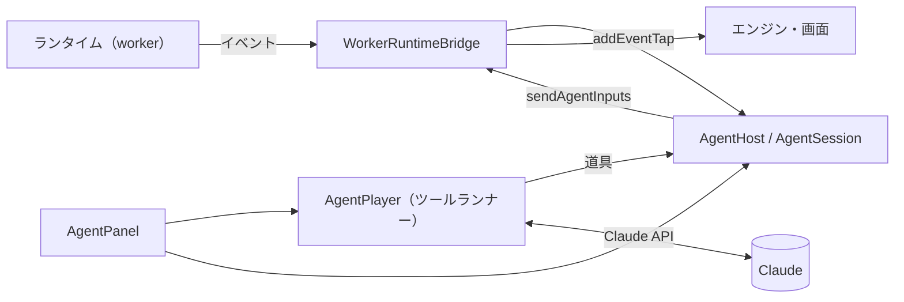

# AI エージェント（AI のプレイと #askagent）

2026-11-28。

画面のゲームを Claude に遊ばせて眺め、いつでも交代できる。プレイ中には `#askagent` で今のゲームについて相談できる。
AI はアプリの中で Claude API を呼ぶ。API キーは利用者自身のもので、ブラウザにだけ保存し、Claude API にだけ送る。

## 使い方

1. ゲーム中、画面右下の **AI** ボタンでパネルを開く。
2. 「設定」で Claude API キーを保存する。モデル（既定は Claude Opus 5.5）、思考の深さ、1回のプレイの使用額の上限も選べる。
3. 「プレイ」の **AI に任せる** で始める。AI の一言の説明、行動、メモがパネルに出る。「考えも表示する」で考えの要約も出る。
4. ゲームの上でキーを押す、クリックする、ホイールを回すと、その場で AI が止まり、あなたに交代する（一時停止になる）。**再開** で AI に戻す。
   一時停止中にあなたが操作したことは AI に伝わり、AI は状況を見直してから続ける。**交代する** で AI のプレイを終える。
5. **速さ** で1手ごとの間隔を変えられる（見やすさのため。0 でできるだけ速く）。
6. `#askagent`（または「相談」タブ）で今のゲームについて質問できる。

AI はセーブ、`#quit`、`#exploremode` をしない（その操作は拒否される）。

## 費用

AI は数手ごとに Claude API を1回呼ぶ。パネルには定価から見積もった使用額が出る（実際の請求は Claude API の請求額）。
使用額が上限に達すると AI は止まる。新しいゲームを始めると数え直す。

- 会話は長くなると要約する（入力が 8 万トークンを超えたら `compactBeforeNextTurn()`）。
- システムプロンプトと会話はプロンプトキャッシュに乗るので、繰り返し読む部分は安い。
- 費用を抑えるには、モデルを Sonnet 5.5 や Haiku 5.5 にする、思考の深さを下げる、の順に効く。

## 仕組み

| 場所 | 役割 |
| --- | --- |
| [src/agent/agent-session.ts](../src/agent/agent-session.ts) | ランタイムのイベントから観測を組み立て、行動を入力にして、一段落まで待つ。ブラウザなしの実行環境（[mcp-headless.md](mcp-headless.md)）と共通 |
| [src/plus/agent/agent-host.ts](../src/plus/agent/agent-host.ts) | 画面のゲームにつなぐ。だれが操作するか（human / agent / paused）、人間の入力での交代、禁止する操作、答えたダイアログを閉じる |
| [src/plus/agent/agent-tools.ts](../src/plus/agent/agent-tools.ts) | AI の道具：`observe`、`act`（最大 10 手。HP が減った、質問が出た、失敗した、交代されたら途中で止まる）、`travel`、`inventory`、`notes` |
| [src/plus/agent/agent-brain.ts](../src/plus/agent/agent-brain.ts) | Claude API。`AgentPlayer`（ツールランナーで遊ぶ）、`askAdvisor`（相談に答える）、使用額の見積もり |
| [src/plus/agent/agent-prompts.ts](../src/plus/agent/agent-prompts.ts) | システムプロンプト（Polypiled のルールの違いを含む） |
| [src/plus/agent/AgentPanel.tsx](../src/plus/agent/AgentPanel.tsx) | パネル |

- **画面との関係**: AI の入力は、開いている入力待ちに番号を付けて送る（人間が先に答えたら拒否される）。
  答えた入力待ちが閉じた時点で、その質問やメニューのダイアログを閉じる（エンジンが次の表示をする前）。
  AI が開いた持ち物の窓や、待たない情報の窓は、行動のあとに閉じる。
- **交代**: パネルの外でのキー、クリック、ホイールで一時停止にする。AI の道具は一時停止のあいだ待ち、交代すると終わる。
- **会話**: ツールランナーはスレッドを使わない（`thread: false`。要約と併用でき、一時停止が長くても切れない）。
  一時停止や交代のあとも会話は続き、新しいゲームで捨てる。
- **拒否されたとき**: Opus 5.5 と Sonnet 5.5 ではサーバー側のフォールバック（`fallbacks: "default"`）を有効にしている。
- **相談**: 質問ごとに、キャラクターが知っていること（マップ、ステータス、最近のメッセージ、持ち物、開いているプロンプト）を添える。`reveal` は使わない。
- **本体**: `#askagent` は WebAssembly 版だけにある拡張コマンドで、`shim_ask_agent` 通知を出すだけ（時間を使わない）。

## テスト

`src/plus/agent/agent.test.ts`（`npm test` に含まれる）で次を確かめる。

- 偽のゲームでの交代、一時停止、禁止する操作、新しいゲーム、`#askagent`
- 偽の Claude API での道具呼び出しのループ
- 使用額の上限と、交代したときの停止
- 送る要求の中身（モデル、思考の深さ、要約とフォールバックの beta）

実際の Claude API での動作は、API キーを使って画面で確かめる。
