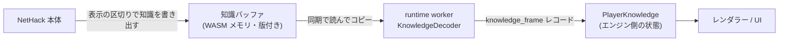

# プレイヤー知識インターフェース

2026-11-17。K0〜K2 を実装（7 章）、K3 は物の正体の扱いを実装（8 章）。

ゲーム本体（`core/NetHack`）からシェル（`src/runtime` → `src/game`）へ、
**プレイヤーが知りうる情報をすべて、構造化された形で**渡す仕組みを作る。
目的はレンダラーの強化で、いまはグリフ・メッセージ・持ち物の文字列から推定している情報を
ゲームが持つ正確な値に置き換える。

[rendering-enhancement-plan.md](rendering-enhancement-plan.md) の P5「ネイティブ書き出し」は
「3 ランタイムの再ビルドが必要」として見送っていたが、いまは本体が 1 つでリポジトリ内にあり、
CI でビルドできるので実現できる。

## 1. 原則: 「知りうる」の境界

書き出してよいのは、**ウィンドウポートが正当に表示できる情報と、その表示の根拠になっている視覚状態**だけ。
ゲームの内部状態（実際の地形、見えていないモンスター、未識別の物の正体）は出さない。

| 出してよい | 出さない |
| --- | --- |
| 表示中のグリフと、その見た目（タイル・色・フラグ） | 物の `otyp`（未識別でも正体が分かる。下の注意を参照） |
| 記憶しているグリフ（`levl[x][y].glyph`）、最後に見た地形（`lastseentyp`） | `levl[x][y].typ`（実際の地形。隠し扉・未探索マスが分かる） |
| 視界ビット（`cansee` / `couldsee` / `templit`）、記憶した明るさ（`waslit`）、見た方向（`seenv`） | 視界外のマスの `lit` |
| 見えている／感知しているモンスター（感知の手段つき） | 見えていないモンスター、擬態の正体 |
| 見えている光源（視界内の位置か主人公が持つもの）と半径 | 視界外の光源 |
| 発見済みの罠（`tseen`）、読んだ刻印 | 未発見の罠・未読の刻印 |
| 主人公の状態（ステータス行の項目と、画面に出る状態） | 内在能力（悟りの巻物などで見たとき以外） |
| 持ち物（`doname` と同じ知識の範囲での種類・状態） | 未識別の物の正体、未確認の呪い |

判定はすべて **C 側で行う**。JS 側で「出してはいけない値をフィルタする」設計にはしない
（WASM のメモリはそもそも全部読めるので、境界はインターフェースの形で守る）。

### 注意: グリフ番号は物の正体を漏らす

NetHack の物のグリフは `otyp`（正体）ごとに振られ、見た目の違いはタイル番号の側で表す
（`o_init.c` の `shuffle_tiles()`）。つまり **グリフ番号から正体が分かる**。
いまのクライアントはグリフ番号をそのまま受け取っている（現状のグリフカタログは物の名前を持たないので、表示には出ていない）。
レンダラーが物ごとの見せ方を増やすほど、正体で分岐してしまう危険が増える。
このインターフェースでは物を **見た目（タイル番号・説明番号）** で表し、グリフ番号は出さない。
既存のグリフ経路の扱い（そのまま残すか、置き換えるか）は 6 章の決めごと。

既存の `floor_glyph_at_position` も `back_to_glyph`（実際の地形）を返しており、未探索マスに使うと地形が分かる。
新しい経路では `lastseentyp` に置き換える。

## 2. 現状

| 経路 | 内容 | 問題 |
| --- | --- | --- |
| `shim_print_glyph` | 変化したマスのグリフ・背景グリフ・モンスター ID | 視界・明暗・記憶かどうかが分からない |
| ヘルパー（`glyphAtHelper` など） | 1 マスずつ問い合わせ | 呼び出し回数が多い。安全に呼べる時機が限られる |
| `create_global` | 名前付きの変数を数個（階層 ID など） | 構造を持つデータには使えない |
| 戦闘通知（`shim_monster_attack` / `killed`） | 攻撃・撃破のイベント | 良い前例。この形を広げる |
| メッセージ・持ち物の文字列 | 魔法の光、持っている光源、装備 | 文字列の解析で推定している |

推定に頼っている主な箇所:

- `rendering/light-field.ts`: 部屋の明暗を明るい床グリフから、記憶部分を光の強さから推定
- `rendering/carried-light.ts`: 持ち物の文字列から光源と半径を推定
- 魔法の光: 「A lit field surrounds you!」を受けて半径 5 マスを記録
- `rendering/glowing-monsters.ts`: 光るモンスターをタイルキーで判別
- 暗い部屋の床・通路の壁の推定（`dark-room-floor`, `rounded-corridor-rock` など）
- `world/world-classification.ts`, `glyphs/behavior.ts`: グリフ番号から地形・扉の種類を分類

## 3. 方式: 表示の区切りごとの「知識フレーム」

1. **C 側に新しいファイル `win/shim/nh3d_knowledge.c`** を足す。本体のゲーム処理には手を入れず、
   読むだけ。既存の変更（`winshim.c` の戦闘通知）と同じく、フックは最小限にする。
2. **書き出しの時機**: マップを表示する `display_nhwindow(WIN_MAP)` の直前（`flush_screen()` の最後もここを通る）。
   ステータスの変化で見え方が変わるとき（盲目など）は視界の再計算とマップの再描画が起きるので、別の時機は要らない。
   いまの `runtime_boundary: "map-display"` と同じ区切りなので、イベントの順序はそのまま保てる。
3. **差分**: 80×21 のマスごとに前回の値を C 側で持ち、変わったマスだけをバッファに入れる。
   レベル移動・再描画・復帰では全マスを送る（`complete` 印つき）。
4. **バッファ**: 固定レイアウトの `Int32Array` 相当。先頭にヘッダ（形式の版、フレーム番号、
   階層 ID、区分ごとの件数）を置く。JS は `HEAPU8` から **同期で読み、コピーしてから** WASM に戻す
   （ポインタを後で使わない。既存の glyph_info と同じ規則）。Asyncify をまたぐ呼び出しは増やさない。
5. **版の確認**: フレームの先頭に形式の版を入れる。版や長さが合わないフレームは捨て（警告は 1 回だけ）、
   フレームが来ない古いビルドと同じく今の推定に戻る。ハンドシェイクには足していない（フレームが届くこと自体が能力の印）。

文字列やコールバックを 1 件ずつ足すのではなく、1 つのバッファにまとめるのは:
呼び出し回数を増やさない（[runtime-protocol-plan.md](runtime-protocol-plan.md) の懸念）、
フレーム単位で一貫した値が読める、版で形式を管理できる、の 3 点のため。

## 4. 書き出す内容

### 4.1 マス（区分 `cells`、差分）

| 項目 | 由来 | 使い道 |
| --- | --- | --- |
| 表示中の見た目: タイル番号、色、`MG_*` フラグ | `gbuf` / `map_glyphinfo` | 今と同じ描画 |
| 種別: 地形 / 物 / モンスター / 罠 / 効果 / 未探索 | グリフの区分 | グリフ番号の分類表を不要にする |
| 最後に見た地形の種類（壁の向き、扉の状態、床・通路・水・溶岩…） | `lastseentyp` と記憶グリフ | 壁形状・扉・液面。推定の置き換え |
| 視界: 見えている / 見通せる / 一時的に明るい | `viz_array` | 「記憶だけ」の色調、探索境界 |
| 明るさ: 今見えていて明るい / 明るかった記憶 | `cansee && (lit \|\| templit)`、`waslit` | ライトフィールドの部屋の明暗 |
| 見た方向 | `seenv` | 壁の見えている面だけを描く |
| 記憶している物の見た目 | 記憶グリフ（物のとき） | 足元・床の物 |
| 発見済みの罠の種類 | `t_at` かつ `tseen` | 罠の立体表示 |
| 物の山（2 つ以上） | `MG_OBJPILE` | 山の表示 |

### 4.2 モンスター（区分 `monsters`、そのフレームで感知しているもの全部）

ID（今の追跡 ID と同じもの）、位置、見た目（タイル）、感知の手段（目視 / テレパシー / 警告 / 探知 / 見えない何か「I」）、
ペット・友好・乗騎、見えている光源かどうか。擬態中は擬態の見た目で出す（正体は出さない）。

### 4.3 光源（区分 `lights`）

主人公が持つ光源と、視界内にある光源の位置・半径・種類（物 / モンスター）。
`light_base` から C 側で選ぶ。持っているランプ・ろうそく・光るモンスター・溶岩以外の光の推定を置き換える。

### 4.4 主人公（区分 `hero`）

位置、向き（直前の移動方向）、表示上の姿（変化中の種族）、乗騎、飲み込まれ中・水中・埋まり・浮遊・
盲目・幻覚・透明（見えるかどうか）など、表示に影響する状態。

### 4.5 階層（区分 `level`）

階層 ID、階層の種類で知りうるもの（鉱山・倉庫番・地下世界…）、入った特殊部屋（店・神殿）の範囲。
カラーグレーディング（rendering-enhancement-plan 4.5）に使う。

### 4.6 後回しにするもの

持ち物の構造化、発見済みの物、呪文、技能、ダンジョン概観。UI には役立つが、レンダラーの強化には今の経路で足りる。
持ち物は 4.3 で光源が取れれば、装備の見た目（持っている武器）の推定だけが残る。

## 5. 段階

| 段階 | 内容 | 本体の変更 |
| --- | --- | --- |
| K0 | 仕様を決め、バッファ形式と C 側の雛形、JS の読み取りとテストを作る。全マスの完全フレームだけ | あり（CI ビルド・`public/` 差し替え） |
| K1 | マスの視界・明るさ・最後に見た地形を差分で。ライトフィールドと探索境界を正確な値に切り替え（推定は旧ビルド用に残す） | あり |
| K2 | 光源・モンスター。持っている光源・光るモンスター・魔法の光の推定を置き換える | あり |
| K3 | 地形の分類をグリフ番号から知識フレームに移す。物を見た目で表す | なし〜少し |
| K4 | 4.6 の項目（必要になったら） | あり |

各段階で: 既存のイベント順序を保つ（知識フレームは `map-display` の区切りの直前に入れる）、
旧ビルドでは推定に戻る、セーブの互換を確認する（書き出しは読むだけなのでセーブ形式は変わらない）、
レベル移動・盲目・幻覚・テレポート・再描画で値が一貫していることをテストする。

## 6. 決めること

1. **既存のグリフ経路の扱い**: 知識フレームと並べて残す（安全・移行が楽）か、K3 で置き換える（漏れがなくなる）か。
   グリフ番号からの正体の漏れを塞ぐには、最終的に置き換えが必要。
2. **最初の範囲**: K0〜K1（マスの視界と明るさ）から始めるか、K2 まで一度に作るか。
3. **ID の扱い**: モンスター ID は今も使っているが、見失ったあとも同じ ID が続くと「同じ個体だ」と分かってしまう。
   許すか、見失ったら新しい ID にするか。

## 7. 実装（K0〜K2）

6 章の決めごとは次のとおり進めた。

1. 既存のグリフ経路は残し、知識フレームを並べて送る（置き換えは K3）。
2. K0〜K2 を一度に作った。
3. モンスター ID は今の追跡と同じ `m_id`（見失っても続く）。変えるなら K3 で一緒に扱う。

### 流れ

| 場所 | 役割 |
| --- | --- |
| `core/NetHack/win/shim/nh3d_knowledge.c` | フレームを作る。前回との差分を取り、変化がなければ何も送らない |
| `core/NetHack/win/shim/winshim.c` | `shim_display_nhwindow` を手書きにし、`WIN_MAP` のとき先に `nh3d_knowledge_publish()` を呼ぶ |
| `sys/unix/hints/include/cross-pre2.501`, `cross-post.501` | WASM ビルドに新しいファイルを足す |
| `src/runtime/knowledge.ts` | 形式の定義と読み取り（`decodeKnowledgeFrame`）。型はエンジン側と共有 |
| `src/runtime/local/world/map-callbacks.ts` | `shim_knowledge_frame` 通知を読んで `knowledge_frame` イベントにする |
| `src/game/engine/world/player-knowledge.ts` | エンジン側の状態（`PlayerKnowledge`）。差分を積み上げ、マスごとに引ける |
| `src/game/engine/rendering/light-field.ts` | 知識があれば部屋の明暗・持っている光・ほかの光源・「見えている」をそこから取る |

フレームは `Int32Array` のまま `pendingShimNotifications` に積まれ、次の `local_callback()`（つまり同じ
`shim_display_nhwindow` 呼び出し）の冒頭で、表示のコールバックより先に届く。WASM の関数を JS から呼び直すことはない。
新しいゲームではフレームが必ず完全フレームから始まる。エンジンは完全フレームを受け取るまで差分を無視し、
ランタイム終了で状態を捨てる。`clear_scene`（描画のやり直し）では捨てない。

JS から `globalThis.nethackGlobal.knowledgeFullRequested = true` を立てると、次のフレームが完全フレームになる
（今は使っていない。再接続のときに使う想定）。

### 形式（版 2、32 ビット整数の並び）

| 位置 | 内容 |
| --- | --- |
| ヘッダ 8 語 | 版, 通し番号, 印（bit0 = 完全）, マス数, モンスター数, 光源数, ターン, 予備 |
| 主人公 8 語 | x, y, 直前の移動方向（dx 下位 8 ビット / dy 次の 8 ビット、符号付き）, 状態の印, 表示タイル, 表示グリフ（モンスターのみ）, 乗騎 ID, 飲み込んだ相手の ID |
| 階層 8 語 | dnum, dlevel, 深さ（`observable_depth`）, 印（鉱山・倉庫番・ゲヘナ・クエスト・最終面・店の中・神殿の中）, 特殊な階（版 2）, 攻撃の回数（版 2。下位 16 ビット = 主人公が攻撃した / 上位 16 ビット = 主人公が攻撃された）, 見えている敵（版 2。数 / 見た目の最高難易度 / 最寄りの距離、各 8 ビット）, 予備 1 |
| マス 4 語 × n | 0: x, y, 視界ビット, `seenv` / 1: 最後に見た地形, 発見済みの罠, 表示の種別, 記憶の種別 / 2: 表示タイル, 記憶タイル / 3: `MG_*` 印, 色 |
| モンスター 4 語 × n | 0: x, y, 感知の手段, 印（ペット・友好・乗騎・主人公） / 1: ID / 2: タイル, 警告の段階 / 3: グリフ（モンスターのみ） |
| 光源 4 語 × n | 0: x, y, 半径, 由来（1 物・2 モンスター） / 1: 見た目の種類, 印（主人公が持つ・主人公自身） / 2: タイル / 3: グリフ（モンスターのみ） |

版 1 では階層の後ろ 4 語が予備（常に 0）だった。JS は版 1 も読み、その 4 語は「特殊な階なし・攻撃なし・敵なし」になる。

版 2 で足した階層の値（背景音楽が使う。`src/audio/music/`）:

- **特殊な階**: メデューサ・城・嘆きの谷・サンクタム・ルディオス砦・ヴラドの塔・ワイズマンの塔（塔の中にいるときだけ）・
  クエストの故郷・地水火風の各面・天上界。着いた時点で主人公に見分けがつく階だけを出す。
- **攻撃の回数**: 主人公が何かを攻撃した回数（近接・投擲・魔法・蹴りなど、`wakeup(mon, TRUE)` と `do_attack()`）と、
  主人公が攻撃された回数（`mattacku()`。遠隔攻撃や外れも数える）。各 16 ビットで一周する。値そのものに意味はなく、
  増えたことだけを見る。
- **見えている敵**: 主人公が見つけられる（`canspotmon`）敵対モンスターのうち、地図にモンスターとして出ているもの
  （家具に化けたミミックは数えない）。難易度は見た目のモンスターのもの。幻覚中は分からないので 0。

各値の意味と印のビットは `src/runtime/knowledge.ts` が正。C 側と JS 側で同じ値を定義しているので、変えるときは両方と版を変える。

漏れを防ぐための扱い:

- `lastseentyp` の隠し扉はその見た目（木・横壁・縦壁）、隠し通路は岩にする。
- 物はタイルだけ。記憶しているグリフ・表示中のグリフも、物ならタイルだけを送る。
- 光源は主人公が持つものと、視界内のもの（床・見えているモンスターが持つ・見えているモンスター自身）だけ。
- 魔法のランプは名前を知るまで普通のランプとして送る。
- テレパシーで感知した光るモンスターは、その位置が見えていなければ光らない（推定のときは光っていた）。

### ライトフィールドの変更点

- 部屋の明暗: 見えているマスは `lit`、見えていないマスは `waslit`。持っている光で照らされた暗い部屋の床は
  部屋とみなさない（推定のときに必要だった「光の届く範囲だけの明るい床を除く」処理は使わない）。
- 持っている光: 光源の一覧から（半径はゲームの値）。持ち物の文字列の解析は使わない。
- ほかの光源: 光るモンスターは種族の色、ほかの人が持つ／床の光源は種類の色で、半径はゲームの値 + 1.5。溶岩は従来どおり。
- テクスチャの α: 主人公が見ているマス。シェーダーは `uLightParams.w = 1` のとき、α だけを「見えている」として扱い、
  ほかは記憶の色調にする（明るい部屋でも離れれば記憶の色調になる）。盲目のときは全体が記憶の色調になり、主人公の光も出ない
  （主人公のいるマスだけは見えている扱い）。
- 記憶の色調（2026-11-17 に強めた）: 見えている場合の半分の明るさ（`memoryBrightness` 0.5）、彩度 0.4、わずかに青寄り。
  見えていないマスの上のモンスター・物（テレパシーで感じたもの、覚えている物）も同じ色調にする。
  スプライト全体が立っているマス 1 つを読むので、縁で半分だけ暗くなることはない。
- 「ライティング」がオンで「部屋と光源のライティング」（`dynamicLighting`）がオフでも、知識フレームがあれば見えている／見えていないの区別だけは描く
  （光はなし、距離による暗さは従来どおり）。
- 魔法の光の青み（メッセージで記録）は従来どおり。明るさ自体はゲームの `lit` で決まる。

### 確かめていないこと

本体の変更は CI でビルドする（この環境にコンパイラがない）。ビルドして `public/nethack-5.*` を差し替えるまで、
アプリでは知識フレームは届かず、すべて従来の推定で動く。差し替えた後に、実際のゲームで次を確かめる:
暗い部屋をランタンで歩く、明るい部屋を出入りする、盲目・幻覚、光の巻物、光るモンスター、店、階層移動、セーブと再開。

## 8. K3: 物の正体を渡さない

調べると、物の正体はグリフ番号だけでなく、次の経路からも分かる状態だった。

| 経路 | 何が分かったか |
| --- | --- |
| 地図・メニューのグリフ番号 | 物の種類そのもの |
| タイル番号 | 同じ見た目の種類（灰色の石、ランプ、同じ色のガラスと宝石、「ルーン付きの短剣」など）はタイルも別なので、そこから種類 |
| 起動時の `runtime_object_tile_map`（全種類のグリフ → タイル） | ゲームごとに混ぜられた見た目の対応表そのもの。見えているタイルから逆引きできる |
| `mapGlyphInfoHelper` / `tileIndexForGlyph` に任意のグリフを渡す | 同上 |
| `floorGlyphAtHelper`（`back_to_glyph`） | 一度も見ていないマスの本当の地形 |
| Vulture タイルの画像選び | 種類ごとの画像を使っていたので、見た目と合わないうえに正体が出ていた |

### 規則

ゲーム中（`u.uz.dlevel > 0`）、主人公が種類を知らない物（`oc_name_known` が偽で、見た目の説明がある種類）は:

- グリフ: その分類の汎用グリフ（`GLYPH_OBJ_OFF + 分類`、山の一番上なら `GLYPH_OBJ_PILETOP_OFF + 分類`）。
- タイル: 見た目のタイル。同じ説明を持つ種類のうち最初の種類の見た目のタイルにそろえる（灰色の石はどれも同じタイル）。
- 色・文字: そのまま（見た目の色）。

知っている種類と、説明のない種類（長剣など）はそのまま。ゲーム開始前は説明がまだ混ぜられていないので何も隠さない。
グリフカタログの生成はこの時点で行うので、カタログは変わらない。

規則は `nh3d_knowledge.c` の `nh3d_public_glyph` / `nh3d_appearance_tile` / `nh3d_public_tile` / `nh3d_public_glyphinfo` の 1 か所にまとめ、
次の経路はすべてそこを通す:

| 経路 | 変更 |
| --- | --- |
| `shim_print_glyph` | 表示と背景の glyph_info を写して置き換えてから渡す |
| `shim_add_menu` | 同上（持ち物・拾うメニューなど） |
| `glyph_at_position`, `nh_top_item_glyph_under_player` | 置き換えたグリフ |
| `nh_top_item_tile_index_under_player`, 知識フレームのタイル | 見た目のタイル |
| `glyph_to_tile_index`（`tileIndexForGlyph`） | 知らない種類の本当のグリフには汎用グリフのタイルを返す（対応表を作れない） |
| `mapGlyphInfoHelper` | 新しい `nh3d_map_glyphinfo` 経由。知らない種類のグリフは汎用グリフとして引く |
| `floor_glyph_at_position` | 一度も見ていないマス（`seenv` が 0）は -1 |

`_map_glyphinfo` などの元の書き出しは、出荷済みの本体との互換確認のために残してある。
WASM のメモリは JS から全部読めるので、これは「シェルのコードがインターフェースから正体を受け取らない」ための線引きで、防御ではない。

### クライアント側

- `map-callbacks.ts`: 表示の glyph_info にあるタイルを優先する（`mapGlyphInfoHelper` で引き直したタイルで上書きしない）。
  汎用グリフを引き直すと汎用のタイルになり、見た目が失われるため。
- `menu-capture.ts`: 同じく、メニューの glyph_info のタイルを優先する。
- Vulture: 物の画像を、描くタイル（見た目）から選ぶ。種類から選ぶのは、タイルで見つからないときだけ。
- 描画・テクスチャ・変化の検出はもともとタイル番号を見ているので、そのまま動く。

### 残したこと

- 地形の分類をグリフ番号から知識フレームへ移すのは見送った。地形のグリフは見えているものしか表さず漏れがないうえ、
  分類はほぼ全部の描画処理がグリフで行っていて、置き換えの手間に見合う利点が今はない。
  知識フレームの「最後に見た地形」が役に立つ場面（物の下の地形など）で個別に使う。
- `floor_glyph_at_position` は、見たことのあるマスでは今の本当の地形を返す（見ていない間に扉が開いた、など）。
- モンスター ID は従来どおり（6 章の 3）。

## 9. 足元の情報（床パネル）

`:` を押さなくても足元が分かるよう、本体は主人公のいるマスの情報を、知識フレームと同じ時機に
通知 `shim_floor_here`（JSON の文字列）で送る。内容が変わったときだけ送る。

| 項目 | 由来 |
| --- | --- |
| `feature` | `dfeature_at()`（`:` と同じ説明。階段・泉・祭壇の神と属性など）。なければ背景の記号の説明（部屋の床、通路など） |
| `trap` | 主人公が見つけた罠の名前（`tseen`） |
| `engraving` | 主人公が読んだ（または触った）刻印だけ（`eread`）。覚えている文字（`remembered_text`）と種類 |
| `objects` | 足元の物。名前は `look_here()` と同じく `doname_with_price()`（店の値段つき）。最初の 40 個まで。グリフとタイルは 8 章の規則（知らない種類は汎用グリフと見た目のタイル） |
| `count` | 足元の物の数 |
| `hidden` | 盲目、飲み込まれている、溶岩や水の中（水中にいないとき）。このときは物を送らない |

クライアントは `src/runtime/floor-here.ts` で読み、`floor_here` イベント → ストアの `floorHere` →
右下の `FloorPanel`（`src/ui/app/floor/`）に出す。床の説明と物の名前は `translateGroundObject` で日本語にする。
物は 5 個まで出し、残りは「ほか N 個」。タッチ操作の端末と VR では出さない。

あわせて、マスに入ったときの足元の説明をやめた（ログには出来事だけを出す方針）。目が見えていれば、物のあるマスに入っても
「ここには◯◯がある」「いくつかの物がある」「ここにある物」のポップアップ、床の種類（`describe_decor` の「ここには階段がある」）、
刻印の「埃に何か書かれている。読んだ: …」を出さない。刻印は `quietly_read_engr_at()` で読んだ扱い（`eread`、走りの停止）だけ行う。
`:` で見たときと、目が見えないときに手探りで分かることは従来どおり出す。

本体の変更点: `look_here()`（自動のとき `obj_cnt > 0` で目が見えていれば黙る。2 個以上はいつも一覧を出さない）、
`describe_decor()`（床の種類を言わない）、`engrave.c`（`read_engr_at()` を `sense_engr()` に分け、黙る版を追加）、
`pickup.c` と `allmain.c` の自動の刻印読み。

起動オプション `pile_limit` の既定値も 5 から 2 にした（今は目が見えないときの手探りにだけ効く）。
保存済みの起動オプションには版番号（`revision`）を付け、版番号のない記録で 5 だったものは 2 に移す。
セーブから再開したゲームはセーブ内の値を使うため、一覧を出さない動作は本体で固定している。
